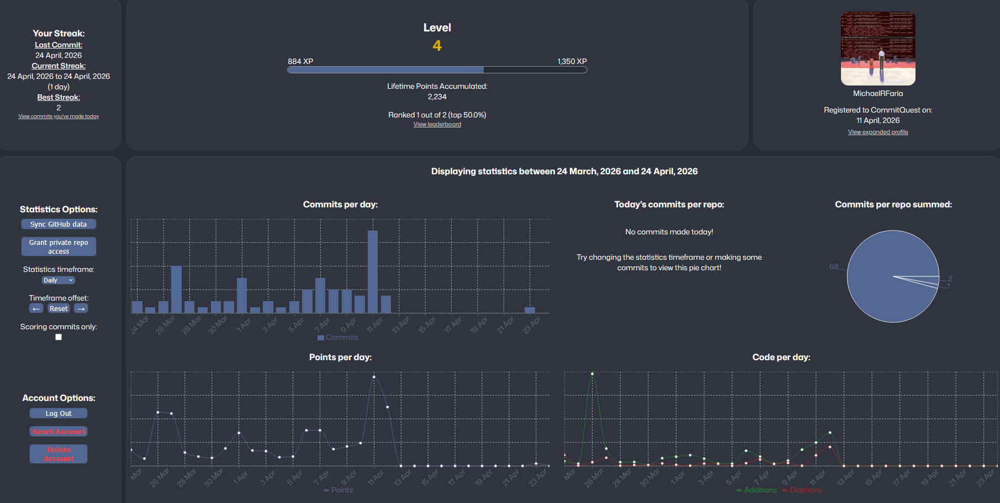
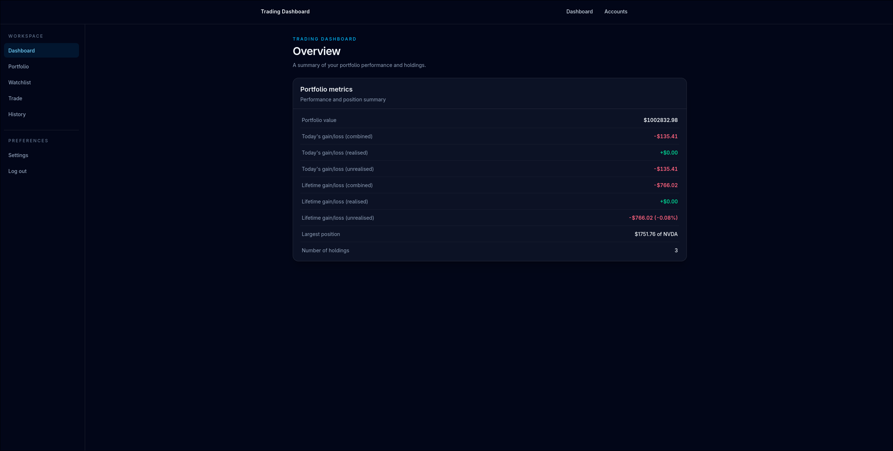
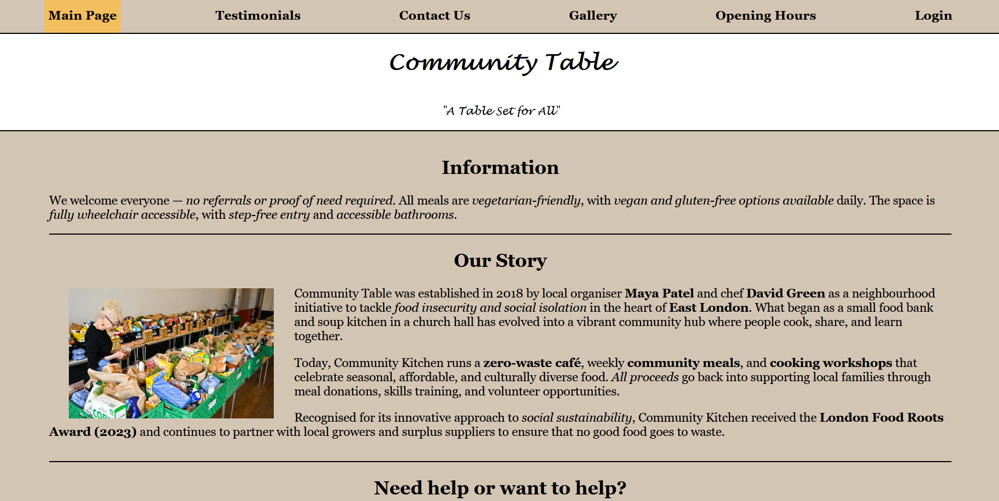
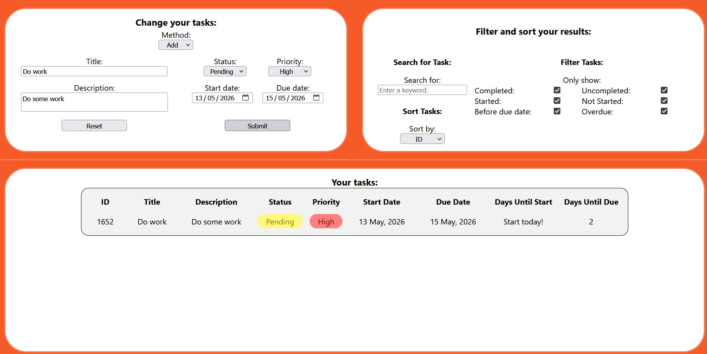

<h2 align="center">Featured Projects</h2>

<table>
  <tr>
    <td width="50%" valign="top">
      <h3 align="center">CommitQuest</h3>
      
      

        A gamified GitHub activity tracker featuring contribution analytics,
        achievements, leaderboards and progression.
      

      

        <strong>React · Spring Boot · PostgreSQL</strong>
      

      

        <a href="https://github.com/MichaelRFaria/CommitQuest">View Repository →</a>
      

    </td>
    <td width="50%" valign="top">
      <h3 align="center">Trading Dashboard</h3>
      
      

        A full-stack trading platform featuring watchlists, portfolio management,
        simulated trades and financial analytics.
      

      

        <strong>Next.js · TypeScript · NestJS · PostgreSQL</strong>
      

      

        <a href="https://github.com/MichaelRFaria/Trading-Dashboard">View Repository →</a>
      

    </td>
  </tr>

  <tr>
    <td width="50%" valign="top">
      <h3 align="center">Community Table Food Bank</h3>
      
      

        A dynamic website for a fictional food bank featuring user authentication,
        role-based functionality and volunteer shift booking.
      

      

        <strong>PHP · Twig · MySQL · Docker</strong>
      

      

        <a href="https://github.com/MichaelRFaria/PHP-Food-Bank-Website">View Repository →</a>
      

    </td>
    <td width="50%" valign="top">
      <h3 align="center">ask-Manager-App</h3>
      
      

        A full-stack task management application featuring CRUD functionality,
        task filtering and sorting.
      

      

        <strong>React · Spring Boot · PostgreSQL</strong>
      

      

        <a href="https://github.com/MichaelRFaria/Task-Manager-App">View Repository →</a>
      

    </td>
  </tr>
</table>

  

